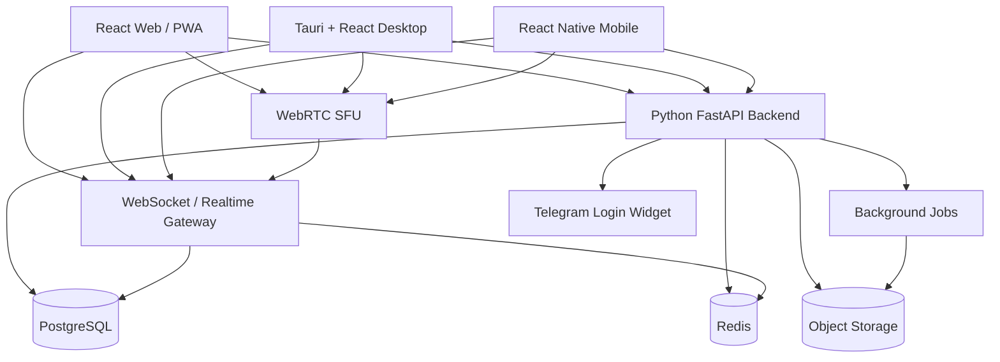

# Архитектура проекта AraChat

## 1. Назначение проекта

**AraChat** — мессенджер для широкой аудитории. Первая версия должна дать пользователю базовый и быстрый сценарий общения: личные чаты, сообщения, вложения, голосовые сообщения, аудиозвонки и демонстрацию экрана.

Основной принцип AraChat Web/v1: выпустить простой и надёжный мессенджер без сложных дополнительных режимов. В первой версии нет семейного режима, детских аккаунтов, групповых чатов, каналов и клиентского E2EE-шифрования.

## 2. Цели продукта

1. Создать современный мессенджер с собственным визуальным стилем, не копирующим существующие продукты.
2. Сфокусировать первую версию на личных чатах и звонках.
3. Обеспечить регистрацию без обязательного подтверждения реального номера телефона.
4. Выдавать каждому пользователю постоянный публичный 16-значный идентификатор AraChat ID.
5. Поддержать два языка интерфейса: русский и английский.
6. Сначала выпустить веб-версию **AraChat Web/v1**, затем Desktop-версию, затем мобильную версию.
7. Использовать ИИ-роли в процессе разработки: Claude для архитектуры, кода, ревью и тестирования; Gemini для UI/UX, дизайна и удобства интерфейса.
8. Подготовить презентацию проекта для демонстрации будущим пользователям, партнёрам и участникам разработки.

## 3. Поддерживаемые платформы

### 3.1 Web / PWA

Первая платформа — веб-версия **AraChat Web/v1**.

Требования:

- работа в современных браузерах;
- адаптация под desktop, планшеты и телефоны;
- возможность установки как веб-приложения на iOS и Android;
- поддержка responsive-интерфейса для разных размеров экрана.

### 3.2 Desktop

Desktop-версия разрабатывается после AraChat Web/v1.

Выбранный подход:

- **Tauri + React**;
- поддержка Windows 10+;
- поддержка macOS 14+;
- выпуск установщика для Windows;
- выпуск `.dmg` для macOS.

Причина выбора Tauri: переиспользование React-интерфейса и общей клиентской логики при более лёгком runtime по сравнению с Electron.

### 3.3 Mobile

Мобильная версия разрабатывается после Desktop-версии.

Выбранный подход:

- **React Native**;
- поддержка iOS 17+;
- поддержка Android 8+.

Причина выбора React Native: близость к React-стеку веб-версии и возможность использовать единые продуктовые паттерны, часть клиентской логики и общий подход к состоянию приложения.

## 4. Языки интерфейса

На первом этапе приложение поддерживает два языка:

- русский;
- английский.

Требования к локализации:

- все пользовательские строки должны храниться через систему i18n;
- язык можно выбрать в настройках;
- при первом запуске язык может определяться по языку браузера или ОС;
- русская и английская версии интерфейса должны быть равноправными, без смешивания языков в пользовательских сценариях.

## 5. Этапы разработки

Разработка делится на три главных этапа:

1. Web version: **AraChat Web/v1**.
2. Desktop version.
3. Mobile version.

У каждого главного этапа есть четыре подэтапа:

1. Проектирование и дизайн.
2. Реализация.
3. Тестирование.
4. Релиз.

### 5.1 Web version: AraChat Web/v1

AraChat Web/v1 — первый публичный релиз веб-версии. По объёму это сфокусированная первая версия обычного мессенджера: личные чаты и звонки без семейного режима, групп, каналов и клиентского E2EE.

Чтобы снизить риск переделок, Web-этап дополнительно делится на внутренние функциональные вехи:

#### 5.1.1 Web Core

- регистрация и авторизация;
- профиль пользователя;
- username;
- публичный 16-значный AraChat ID;
- базовые настройки;
- список чатов;
- личные чаты 1-на-1;
- отправка и получение текстовых сообщений;
- WebSocket-соединение;
- базовая синхронизация между устройствами.

#### 5.1.2 Web Communication

- голосовые сообщения;
- отправка фото;
- отправка видео;
- отправка документов и других файлов;
- реакции на сообщения;
- смайлики;
- статусы сообщений: отправлено, доставлено, прочитано;
- статусы активности: печатает, в сети, не в сети, был в сети недавно.

#### 5.1.3 Web Calls & Release

- аудиозвонки;
- демонстрация экрана во время звонка;
- базовая безопасность аккаунта;
- жалобы на пользователей и сообщения;
- блокировки пользователей;
- удаление пользователей из контактов;
- история входов;
- список активных устройств;
- удаление аккаунта;
- финальная PWA-адаптация;
- финальное тестирование;
- подготовка релизных материалов;
- подготовка презентации проекта;
- публичный релиз AraChat Web/v1.

### 5.2 Desktop version

Desktop-версия строится после стабилизации AraChat Web/v1.

Подэтапы:

1. Проектирование и дизайн desktop-интерфейса.
2. Реализация клиента на Tauri + React.
3. Тестирование на Windows 10+ и macOS 14+.
4. Релиз установщиков для Windows и macOS.

### 5.3 Mobile version

Mobile-версия строится после Desktop-версии.

Подэтапы:

1. Проектирование и дизайн мобильного интерфейса.
2. Реализация клиента на React Native.
3. Тестирование на iOS 17+ и Android 8+.
4. Релиз мобильных приложений.

## 6. Функциональные требования

### 6.1 Регистрация и авторизация

Пользователь может зарегистрироваться через:

- Telegram Login Widget.

После первичной регистрации пользователь:

- получает постоянный 16-значный AraChat ID;
- выбирает username;
- задаёт пароль;
- создаёт PIN/код доступа для быстрого входа на доверенном устройстве;
- получает резервный код восстановления.

Зарегистрированный пользователь может авторизоваться через:

- AraChat ID и пароль;
- Telegram Login Widget, если Telegram уже привязан к аккаунту;
- PIN/код доступа на доверенном устройстве;
- резервный код восстановления в сценарии восстановления доступа.

E-mail не используется для регистрации, авторизации, восстановления доступа или уведомлений.

Номер телефона не требуется для регистрации и авторизации.

Дополнительно:

- пользователь может добавить номер телефона в настройках;
- номер телефона является необязательным полем профиля;
- номер телефона не влияет на регистрацию, вход, поиск, права доступа или восстановление аккаунта;
- пользователь сам решает в настройках, показывать ли номер телефона публично в профиле;
- двухфакторная защита планируется для следующих версий.

### 6.2 Профиль пользователя

Профиль содержит:

- отображаемое имя;
- username;
- публичный 16-значный AraChat ID;
- аватар;
- язык интерфейса;
- тема дизайна;
- необязательный номер телефона;
- настройка публичного отображения номера телефона.

Аватар:

- в первой версии доступно 20 встроенных вариантов;
- пользователь может загрузить собственную аватарку.

Темы дизайна:

- основная тема по умолчанию — AraChat Halo;
- альтернативные темы — AraChat Orbit и AraChat Aurora;
- пользователь может менять тему в настройках приложения;
- выбранная тема сохраняется в профиле и синхронизируется между устройствами.

### 6.3 Уникальный 16-значный AraChat ID

Каждому пользователю после регистрации выдаётся уникальный идентификационный номер из 16 цифр.

Правила:

- ID публичный;
- ID используется для поиска пользователя;
- ID нельзя изменить;
- ID удаляется вместе с аккаунтом;
- ID должен генерироваться так, чтобы не раскрывать порядок регистрации;
- система должна гарантировать отсутствие коллизий.

Рекомендуемый подход:

- генерировать криптографически случайное 16-значное число;
- проверять уникальность в PostgreSQL через уникальный индекс;
- при коллизии повторять генерацию;
- не использовать автоинкремент или последовательные номера.

### 6.4 Username

Username нужен отдельно от AraChat ID.

Требования:

- username уникален;
- username может использоваться для поиска;
- пользователь может изменять username сколько угодно раз в течение недели, но не более трёх раз за один день;
- система должна хранить историю изменений username для аудита и защиты от злоупотреблений;
- username не должен заменять AraChat ID как постоянный идентификатор.

### 6.5 Личные чаты

Личные чаты 1-на-1 входят в AraChat Web/v1.

Функции:

- отправка текстовых сообщений;
- отправка голосовых сообщений;
- отправка фото, видео и файлов;
- реакции;
- смайлики;
- редактирование сообщений;
- удаление сообщений;
- статусы отправки, доставки и прочтения;
- typing-индикатор;
- синхронизация между устройствами.

### 6.6 Сообщения и вложения

Поддерживаемые типы сообщений:

- текст;
- голосовое сообщение;
- фото;
- видео;
- документ;
- другой файл;
- системное сообщение.

Максимальный размер фото, видео, голосового сообщения и любого файла в AraChat Web/v1 — **30 МБ**.

Требования:

- сообщения хранятся на сервере;
- сообщения синхронизируются между устройствами пользователя;
- вложения хранятся в объектном хранилище;
- метаданные сообщений хранятся в PostgreSQL;
- для медиа нужна проверка типа файла, размера и безопасности;
- для будущих версий необходимо предусмотреть фоновые задачи обработки медиа.

Политика удаления:

- удаление сообщений работает **у всех участников**, а не только локально у одного пользователя;
- после удаления сообщение исчезает из приложения;
- удалённые сообщения и связанные вложения временно хранятся на сервере в течение одного месяца;
- в настройках должна быть специальная кнопка восстановления удалённых сообщений;
- после истечения одного месяца удалённые сообщения и вложения автоматически удаляются с сервера.

### 6.7 Голосовые сообщения

Голосовые сообщения входят в AraChat Web/v1.

Требования:

- запись голосового сообщения в клиенте;
- отправка как вложения специального типа;
- хранение в объектном хранилище;
- отображение длительности;
- воспроизведение в чате;
- адаптация под desktop и mobile-интерфейсы.

### 6.8 Аудиозвонки и демонстрация экрана

Аудиозвонки входят в AraChat Web/v1.

Функции:

- аудиозвонок между пользователями;
- демонстрация экрана во время звонка;
- сигналинг через backend/WebSocket;
- медиа-соединение через WebRTC;
- отдельный WebRTC SFU для масштабирования звонков.

Видеозвонки не входят в AraChat Web/v1 и планируются для будущих версий.

### 6.9 Статусы и presence

Поддерживаемые статусы сообщений:

- отправлено;
- доставлено;
- прочитано.

Поддерживаемые статусы пользователя:

- в сети;
- не в сети;
- был в сети недавно;
- печатает.

Presence-данные должны храниться в Redis или другом быстром ephemeral-хранилище, а не быть основным источником истины в PostgreSQL.

### 6.10 Реакции и смайлики

Функции:

- пользователь может поставить реакцию на сообщение;
- реакции синхронизируются в realtime;
- смайлики доступны в поле ввода сообщения;
- список реакций и правила их использования уточняются на этапе дизайна.

### 6.11 Жалобы, блокировки и модерация

Пользователь может:

- заблокировать другого пользователя;
- удалить пользователя из контактов;
- отправить жалобу на пользователя;
- отправить жалобу на сообщение.

Важное правило для приватности:

- пользователь должен понимать, какие данные он передаёт при жалобе;
- жалоба на сообщение должна включать ссылку на сообщение и необходимые данные для проверки модератором.

Детальные правила модерации фиксируются ближе к релизу AraChat Web/v1 в политике конфиденциальности и пользовательском соглашении.

### 6.12 Настройки, устройства и история входов

В настройках пользователь видит:

- профиль;
- язык интерфейса;
- тему дизайна: AraChat Halo, AraChat Orbit или AraChat Aurora;
- номер телефона, если добавлен;
- настройку публичного отображения номера телефона;
- активные устройства;
- историю входов;
- настройки безопасности;
- восстановление удалённых сообщений в течение одного месяца после удаления;
- возможность удалить аккаунт.

Удаление аккаунта должно:

- удалять или обезличивать персональные данные согласно выбранной политике;
- освобождать активные сессии;
- удалять AraChat ID вместе с аккаунтом.

## 7. Нефункциональные требования

### 7.1 Безопасность

Требования:

- HTTPS для всего трафика;
- безопасное хранение паролей через современный password hashing;
- защита от перебора паролей и кодов;
- rate limiting;
- защита WebSocket-соединений;
- безопасная работа с загрузками файлов;
- проверка Telegram Login Widget подписи;
- журналирование критичных действий;
- контроль активных сессий;
- подготовка к двухфакторной защите в будущих версиях.

### 7.2 Приватность

Требования:

- номер телефона необязателен;
- номер телефона не участвует в авторизации и поиске, если отдельно не будет принято другое решение;
- личные данные должны собираться минимально;
- пользователь должен понимать, какие данные хранятся на сервере и какие данные передаются при жалобе.

### 7.3 Масштабируемость

Архитектура должна позволять разделять систему на сервисы по мере роста.

На первом этапе допустим модульный монолит на Python/FastAPI с выделенными слоями:

- auth;
- users;
- chats;
- messages;
- media;
- realtime;
- calls;
- moderation;
- notifications;
- admin.

По мере роста можно выделять отдельные сервисы:

- realtime gateway;
- media service;
- calls service;
- notification service;
- moderation service.

### 7.4 Производительность

Требования:

- realtime-события не должны блокировать основную HTTP-логику;
- presence должен работать через Redis или аналогичное быстрое хранилище;
- большие файлы должны загружаться напрямую в объектное хранилище через подписанные URL или аналогичный механизм;
- медиа-обработка должна выполняться фоновыми задачами;
- список чатов и история сообщений должны иметь пагинацию.

### 7.5 Надёжность

Требования:

- резервное копирование PostgreSQL;
- резервное копирование критичных объектов файлового хранилища;
- миграции базы данных;
- повторяемые фоновые задачи;
- мониторинг ошибок backend и frontend;
- аудит действий безопасности;
- технические логи хранятся один год;
- аудит критичных действий хранится не менее одного года, а для действий безопасности, модерации, удаления аккаунтов и административных операций рекомендуется хранение до трёх лет, если это не конфликтует с будущей политикой конфиденциальности и требованиями законодательства.

### 7.6 Доступность

Интерфейс должен учитывать:

- читаемые размеры текста;
- контрастность;
- клавиатурную навигацию в веб-версии;
- понятные состояния ошибок;
- адаптацию под мобильные экраны;
- локализацию сообщений об ошибках.

### 7.7 Локализация RU/EN

Требования:

- единая система ключей переводов;
- проверка отсутствующих переводов;
- отсутствие hardcoded-строк в интерфейсе;
- возможность добавления новых языков в будущем.

## 8. Архитектура системы

### 8.1 Общая схема

### 8.2 Frontend Web

Стек:

- React;
- JavaScript;
- PWA;
- i18n для русского и английского;
- WebSocket-клиент;
- WebRTC-клиент для звонков и демонстрации экрана.

Задачи:

- интерфейс чатов;
- профиль и настройки;
- загрузка файлов;
- запись голосовых сообщений;
- управление звонками;
- адаптация под desktop, планшеты и телефоны.

### 8.3 Backend API

Стек:

- Python;
- FastAPI;
- PostgreSQL;
- Redis;
- WebSocket;
- фоновые задачи;
- объектное хранилище.

Backend отвечает за:

- регистрацию и авторизацию;
- пользователей и профили;
- AraChat ID;
- username;
- чаты;
- сообщения;
- вложения;
- жалобы и блокировки;
- историю входов;
- активные устройства;
- настройки;
- административные операции.

### 8.4 Realtime / WebSocket

Realtime-слой отвечает за:

- доставку новых сообщений;
- статусы доставки и прочтения;
- typing-индикаторы;
- presence;
- реакции;
- изменения чатов;
- сигналинг звонков.

Redis используется для:

- presence;
- pub/sub между инстансами realtime gateway;
- rate limiting;
- временных данных;
- короткоживущих кодов и токенов, если это соответствует политике безопасности.

### 8.5 База данных

Основная база данных: **PostgreSQL**.

PostgreSQL хранит:

- пользователей;
- профили;
- AraChat ID;
- username;
- auth-аккаунты;
- сессии и устройства;
- чаты;
- участников чатов;
- сообщения и метаданные сообщений;
- вложения и ссылки на объектное хранилище;
- жалобы;
- блокировки;
- аудит действий.

### 8.6 Хранилище файлов

Для вложений нужно объектное хранилище, совместимое с S3-подходом или аналогичной моделью.

Хранит:

- аватарки;
- фото;
- видео;
- документы;
- голосовые сообщения;
- другие файлы.

Требования:

- проверка размера;
- проверка MIME-типа;
- защита от небезопасных файлов;
- разграничение доступа;
- приватные ссылки или подписанные URL;
- возможность удаления файлов при удалении аккаунта или сообщения.

Предпочтительный бесплатный или условно бесплатный вариант для старта: **Cloudflare R2 Free Tier** как S3-compatible хранилище. По данным публичных обзоров, у Cloudflare R2 есть бесплатный лимит около 10 ГБ хранения и отсутствие платы за исходящий трафик в рамках модели R2. Перед релизом тарифы и лимиты нужно перепроверить по официальной документации.

Альтернативы:

- Backblaze B2 Free Tier, если лимиты и условия подходят проекту;
- локальное self-hosted S3-compatible хранилище, например MinIO, если внешний бесплатный лимит недостаточен. В этом случае само ПО бесплатно, но сервер, диск, резервное копирование и трафик всё равно требуют инфраструктуры.

### 8.7 WebRTC-звонки

Для аудиозвонков и демонстрации экрана используется WebRTC.

Компоненты:

- signaling через backend/WebSocket;
- STUN/TURN для соединений через NAT;
- SFU для масштабируемости;
- клиентская интеграция в Web, Desktop и Mobile.

Для старта нужен бесплатный готовый WebRTC SFU. Предпочтительный вариант: **LiveKit self-hosted** как open-source решение с готовой платформенной логикой и клиентскими SDK. Альтернативы для технического сравнения: mediasoup, Janus, Jitsi Videobridge.

Важно: бесплатным является open-source/self-hosted подход. Серверная инфраструктура, TURN-трафик и эксплуатация всё равно могут создавать расходы.

### 8.8 Push-уведомления и уведомления безопасности

E-mail-уведомления в AraChat Web/v1 не используются, так как проект отказывается от e-mail как канала регистрации, авторизации, восстановления и уведомлений.

Уведомления безопасности должны быть реализованы внутри приложения:

- уведомление о новом входе;
- уведомление о смене пароля;
- уведомление о создании или сбросе PIN/кода доступа;
- уведомление об использовании резервного кода восстановления;
- уведомление о привязке или изменении Telegram-аккаунта;
- уведомление о завершении активной сессии.

Push-уведомления:

- для PWA, Desktop и Mobile проектируются заранее;
- конкретная реализация зависит от этапа платформы.

### 8.9 Администрирование и модерация

Административная часть должна поддерживать:

- просмотр жалоб;
- обработку жалоб;
- блокировку пользователей;
- аудит действий модераторов;
- удаление пользователя;
- мониторинг количества пользователей;
- ручной запуск процедуры восстановления доступа после обращения пользователя через официальный Telegram-бот восстановления.

Администратор не должен иметь произвольный доступ к переписке пользователей без явного основания в рамках модерации или процедуры поддержки.

Доступ к админ-панели:

- админ-панель доступна только одному назначенному пользователю;
- конкретного администратора владелец проекта называет отдельно;
- доступ должен быть защищён усиленной авторизацией;
- все действия администратора должны логироваться в AuditLog;
- восстановление доступа через админ-панель допускается только после заявки из официального Telegram-бота восстановления;
- админ-панель должна показывать Telegram user ID, username Telegram, request id и время обращения из бота;
- если у AraChat-аккаунта есть привязанный Telegram identity, восстановление допускается только после проверки совпадения Telegram identity из заявки с Telegram identity, привязанной к указанному AraChat ID;
- админ-панель не должна показывать администратору текущий пароль, PIN или резервный код пользователя;
- админ-панель может только создать одноразовую процедуру сброса пароля и резервного кода;
- расширение числа администраторов является отдельным архитектурным решением.

## 9. Модель данных

Предварительные основные сущности:

- User;
- UserProfile;
- AuthIdentity;
- Session;
- Device;
- LoginHistory;
- Chat;
- ChatParticipant;
- Message;
- MessageStatus;
- MessageReaction;
- Attachment;
- VoiceMessageMetadata;
- Block;
- Report;
- AuditLog;
- UsernameChangeHistory;
- DeletedMessageRetention;
- RecoveryCode;
- TrustedDevicePin;
- TelegramRecoveryRequest.

### 9.1 User

Хранит базовый аккаунт пользователя:

- internal id;
- AraChat ID;
- Telegram identity, если подключён;
- статус аккаунта;
- дата создания;
- дата удаления, если аккаунт удалён.

### 9.2 UserProfile

Хранит профиль:

- display name;
- username;
- avatar;
- optional phone;
- флаг публичного отображения номера телефона;
- language.

### 9.3 Chat

Типы чатов:

- direct.

### 9.4 Message

Хранит:

- chat id;
- sender id;
- тип сообщения;
- payload сообщения;
- timestamps;
- edit metadata;
- delete metadata;
- retention deadline для удалённых сообщений, если сообщение находится в периоде восстановления.

### 9.5 UsernameChangeHistory

Хранит историю изменения username:

- user id;
- старый username;
- новый username;
- время изменения;
- источник изменения;
- данные для проверки лимита не более трёх изменений за один день.

### 9.6 DeletedMessageRetention

Хранит данные для восстановления удалённых сообщений в течение одного месяца:

- message id;
- chat id;
- owner/scope удаления;
- срок окончательного удаления;
- ссылки на вложения, ожидающие окончательного удаления;
- статус восстановления или окончательного удаления.

### 9.7 RecoveryCode

Хранит данные резервного кода восстановления:

- user id;
- хеш резервного кода;
- дата создания;
- дата последнего использования;
- статус: активен, использован, отозван;
- audit metadata.

Резервный код восстановления должен показываться пользователю один раз при регистрации или при ручной регенерации. Сервер не хранит код в открытом виде.

### 9.8 TrustedDevicePin

Хранит данные PIN/кода доступа для доверенного устройства:

- user id;
- device id;
- хеш PIN/кода доступа или зашифрованный локальный секрет;
- дата создания;
- дата последнего использования;
- счётчик неудачных попыток;
- статус доверенного устройства.

PIN/код доступа используется только для быстрого входа на уже доверенном устройстве и не заменяет пароль как основной фактор авторизации.

### 9.9 TelegramRecoveryRequest

Хранит заявку на ручное восстановление доступа через официальный Telegram-бот:

- request id;
- AraChat ID, указанный пользователем;
- Telegram user ID обратившегося;
- Telegram username обратившегося, если доступен;
- время создания заявки;
- статус заявки: новая, проверяется, одобрена, отклонена, закрыта;
- id администратора, обработавшего заявку;
- audit metadata.

Заявка из бота не является автоматическим доказательством владения аккаунтом. Она создаёт проверяемый след обращения и передаёт данные в админ-панель.

## 10. Авторизация и сессии

### 10.1 Регистрация через Telegram

Если пользователь не зарегистрирован и у него нет AraChat ID, приложение предлагает регистрацию через Telegram Login Widget.

После успешной проверки Telegram Login Widget система:

- создаёт аккаунт пользователя;
- выдаёт постоянный 16-значный AraChat ID;
- предлагает выбрать username;
- предлагает задать пароль;
- предлагает создать PIN/код доступа для быстрого входа на доверенном устройстве;
- показывает резервный код восстановления и просит пользователя сохранить его.

### 10.2 Вход зарегистрированного пользователя

Основной сценарий входа зарегистрированного пользователя:

- AraChat ID;
- пароль.

Дополнительные сценарии:

- вход через Telegram Login Widget, если Telegram уже привязан к аккаунту;
- быстрый вход по PIN/коду доступа на доверенном устройстве;
- восстановление доступа через резервный код восстановления.

### 10.3 Пароль

Пароль задаётся после регистрации через Telegram.

Требования:

- безопасное хеширование пароля;
- проверка минимальной сложности пароля;
- защита от перебора;
- rate limiting;
- журналирование попыток входа;
- уведомления о новых входах внутри приложения.

### 10.4 Telegram Login Widget

Требования:

- проверка подписи Telegram;
- привязка Telegram identity к аккаунту;
- защита от подмены данных;
- понятный UX для входа и привязки Telegram;
- запрет автоматической перерегистрации, если Telegram-аккаунт уже привязан к существующему AraChat ID.

### 10.5 Резервный код восстановления

Резервный код восстановления нужен на случай потери пароля или проблем с Telegram-доступом.

Формат резервного кода восстановления:

- 24 символа;
- латинские буквы верхнего регистра и цифры, кроме визуально похожих символов `0`, `O`, `1`, `I`;
- отображение группами по 4 символа, например `ABCD-EFGH-JKLM-NPQR-STUV-WXYZ`;
- генерация через криптографически безопасный генератор случайных чисел.

Требования:

- код должен быть достаточно длинным и случайным;
- сервер хранит только хеш кода;
- код показывается пользователю один раз;
- пользователь может регенерировать код в настройках после подтверждения доступа;
- использование кода должно сбрасывать старый код и требовать создания нового пароля;
- использование кода логируется в AuditLog;
- если пользователь потерял пароль, Telegram-доступ и резервный код, восстановление аккаунта штатными средствами невозможно.

После пяти неудачных попыток ввода резервного кода восстановление через код временно блокируется. Дальнейшее восстановление выполняется через обращение пользователя в официальный Telegram-бот восстановления и ручную процедуру в админ-панели.

Ручная процедура восстановления через админ-панель:

1. Пользователь пишет в официальный Telegram-бот восстановления и указывает свой AraChat ID.
2. Бот фиксирует Telegram user ID, username Telegram, request id и время обращения.
3. Бот создаёт заявку на восстановление в админ-панели.
4. Администратор проверяет в админ-панели, что Telegram identity из заявки совпадает с Telegram identity, привязанной к указанному AraChat ID.
5. Если совпадение подтверждено, администратор запускает одноразовую процедуру сброса доступа.
6. Пользователь задаёт новый пароль и получает новый резервный код восстановления.
7. Все действия фиксируются в AuditLog.

Если у аккаунта нет привязанного Telegram identity, бот всё равно может создать заявку, но администратор не должен автоматически восстанавливать доступ только по текстовому обращению. Для таких случаев нужна отдельная усиленная проверка, которая проектируется отдельно.

Упрощённая процедура для аккаунтов с привязанным Telegram:

1. Пользователь пишет в официальный Telegram-бот восстановления.
2. Бот определяет Telegram user ID и предлагает указать AraChat ID.
3. Backend сверяет Telegram user ID с Telegram identity, привязанной к AraChat ID.
4. Если данные совпадают, заявка помечается как подтверждённая Telegram identity.
5. Администратор в админ-панели запускает одноразовый сброс доступа.
6. Пользователь задаёт новый пароль и получает новый резервный код восстановления.

Если Telegram identity не совпадает, восстановление отклоняется или переводится в ручную проверку повышенного риска.

### 10.6 PIN/код доступа для доверенного устройства

PIN/код доступа используется для быстрого входа на уже доверенном устройстве.

Требования:

- PIN/код доступа не является основным способом восстановления аккаунта;
- длина PIN — от 4 до 8 цифр;
- PIN привязан к конкретному устройству или браузеру;
- разрешено 5 неудачных попыток ввода PIN;
- после 5 неудачных попыток PIN на этом доверенном устройстве блокируется;
- срок доверия устройства — один год;
- для нового устройства требуется основной вход через AraChat ID + пароль или Telegram;
- пользователь может сбросить доверенные устройства в настройках;
- PIN/код доступа не должен храниться на сервере в открытом виде.

### 10.7 Сессии и устройства

Пользователь должен видеть:

- список активных устройств;
- историю входов;
- время входа;
- примерное устройство/браузер;
- возможность завершить сессию.

## 11. Безопасность сообщений

В AraChat Web/v1 не реализуется клиентское E2EE-шифрование. Для ускорения релиза сообщения хранятся и обрабатываются сервером в обычной серверной модели безопасности.

Требования для первой версии:

- весь трафик проходит только через HTTPS/WSS;
- доступ к сообщениям ограничивается правами участников личного чата;
- серверная часть проверяет авторизацию на каждую операцию чтения, отправки, редактирования и удаления сообщений;
- вложения выдаются через приватные ссылки или подписанные URL;
- критичные действия логируются в AuditLog;
- администраторские и модераторские действия должны быть ограничены ролями и журналироваться;
- пользователь должен понимать, какие данные передаются при жалобе.

Клиентское E2EE, группы, каналы и семейный режим могут быть спроектированы отдельно для будущих версий, но не входят в AraChat Web/v1.

## 12. Синхронизация между устройствами

Требования:

- пользователь может иметь несколько активных устройств;
- сообщения синхронизируются между устройствами;
- статусы сообщений обновляются на всех устройствах;
- настройки профиля синхронизируются;
- активные устройства отображаются в настройках;
- завершение сессии на устройстве должно прекращать доступ этого устройства.

## 13. Роли ИИ в проекте

### 13.1 Claude

Claude отвечает за инженерную часть разработки:

- архитектура проекта;
- декомпозиция задач;
- backend-разработка;
- frontend-разработка;
- интеграция WebSocket;
- проектирование модели данных;
- ревью кода;
- тестирование;
- анализ ошибок;
- подготовка технической документации.

### 13.2 Gemini

Gemini отвечает за UI/UX и дизайн:

- исследование пользовательского опыта;
- идеи интерфейса;
- дизайн-концепции;
- удобство навигации;
- адаптация под разные экраны;
- сценарии onboarding;
- предложения по визуальному стилю;
- анализ понятности интерфейса.

### 13.3 Правила взаимодействия ИИ-ролей

1. Claude принимает технические решения, если они касаются архитектуры, безопасности, backend/frontend-кода и тестирования.
2. Gemini предлагает UI/UX-решения, но техническая реализуемость проверяется Claude.
3. Спорные решения фиксируются в архитектурном документе или ADR.
4. Пользователь утверждает ключевые продуктовые решения.
5. ИИ не должен менять утверждённую архитектуру без явного согласования.

## 14. Презентация проекта

Для показа проекта другим пользователям и участникам должна быть подготовлена красивая презентация AraChat в формате **PowerPoint (`.pptx`)**.

Gemini помогает с визуальным дизайном презентации, композицией слайдов, подачей UI/UX-идеи и общей эстетикой. Claude отвечает за точность технического содержания, архитектурные формулировки и проверку того, что презентация не обещает функций, которых нет в архитектуре.

Цели презентации:

- объяснить идею AraChat простым языком;
- показать фокус первой версии на личных чатах и звонках;
- показать базовую безопасность и приватность;
- показать платформенный roadmap;
- объяснить, почему регистрация не требует номера телефона;
- показать внешний вид и ключевые сценарии после выбора дизайна.

Предлагаемая структура презентации:

1. Название: AraChat.
2. Проблема: пользователю нужен простой мессенджер без обязательной привязки к номеру телефона.
3. Решение: быстрый первый релиз с личными чатами, вложениями и звонками.
4. Основные функции AraChat Web/v1.
5. AraChat ID вместо обязательного номера телефона.
6. Личные чаты и статусы сообщений.
7. Голосовые сообщения, файлы и медиа.
8. Аудиозвонки и демонстрация экрана.
9. Базовая безопасность аккаунта и приватность.
10. Поддерживаемые платформы.
11. Roadmap: Web, Desktop, Mobile.
12. Роли ИИ в разработке.
13. Следующие шаги.

Презентация должна быть подготовлена после фиксации дизайна и ключевых экранов, чтобы не показывать абстрактный интерфейс без визуального решения.

Требования к презентации:

- формат: PowerPoint `.pptx`;
- стиль: современный, аккуратный, визуально сильный;
- дизайн: готовится с участием Gemini;
- содержание: проверяется Claude на соответствие архитектуре;
- язык: русский, при необходимости позже можно подготовить английскую версию.

## 15. Roadmap

### 15.1 Web version: AraChat Web/v1

#### Проектирование и дизайн

- финализация требований;
- выбор визуального направления;
- проектирование UX потоков;
- проектирование UI-kit;
- проектирование адаптивных экранов;
- проектирование модели данных;
- проектирование презентации проекта в формате PowerPoint.

#### Реализация

- backend foundation;
- auth;
- users/profile;
- AraChat ID;
- chats/messages;
- realtime;
- files/media;
- voice messages;
- moderation;
- calls/screen sharing;
- PWA;
- i18n RU/EN.

#### Тестирование

- unit-тесты backend;
- frontend component tests;
- integration tests;
- realtime tests;
- auth/security tests;
- file upload tests;
- cross-browser tests;
- responsive tests;
- accessibility checks.

#### Релиз

- подготовка production-инфраструктуры;
- миграции базы данных;
- мониторинг;
- логирование;
- резервное копирование;
- релизная документация;
- презентация проекта в формате PowerPoint;
- запуск AraChat Web/v1.

### 15.2 Desktop version

#### Проектирование и дизайн

- адаптация UX под desktop;
- проектирование оконных сценариев;
- системные уведомления;
- безопасность локального хранения;
- правила упаковки и обновлений.

#### Реализация

- Tauri shell;
- интеграция React UI;
- desktop auth/session;
- WebSocket;
- WebRTC;
- загрузка файлов;
- локальные уведомления;
- сборка для Windows/macOS.

#### Тестирование

- Windows 10+;
- macOS 14+;
- установщики;
- обновления;
- звонки;
- демонстрация экрана;
- безопасность локального окружения.

#### Релиз

- Windows installer;
- macOS `.dmg`;
- release notes;
- публикация файлов загрузки;
- инструкция установки.

### 15.3 Mobile version

#### Проектирование и дизайн

- мобильная навигация;
- адаптация чатов;
- запись голосовых;
- push-сценарии;
- мобильные звонки.

#### Реализация

- React Native project;
- auth;
- chats;
- realtime;
- media upload;
- voice messages;
- push notifications;
- calls;
- i18n RU/EN.

#### Тестирование

- iOS 17+;
- Android 8+;
- push;
- background/foreground behavior;
- media permissions;
- microphone permissions;
- screen sharing limitations;
- accessibility.

#### Релиз

- подготовка сборок;
- release notes;
- инструкции публикации;
- финальная проверка совместимости.

## 16. Риски и спорные решения

### 16.1 Большой объём AraChat Web/v1

AraChat Web/v1 всё ещё включает realtime-чаты, файлы, голосовые сообщения и звонки. Риск: увеличение сложности из-за WebSocket, загрузок и WebRTC.

Снижение риска:

- вести реализацию через внутренние вехи Web Core, Web Communication, Web Calls & Release;
- не начинать сложные функции до фиксации базовых моделей данных;
- отдельно проектировать звонки и инфраструктуру WebRTC.

### 16.2 Звонки и демонстрация экрана в первой версии

Звонки и screen sharing добавляют сложность инфраструктуры и клиентских разрешений.

Снижение риска:

- использовать WebRTC;
- заранее заложить STUN/TURN/SFU;
- отделить signaling от хранения сообщений;
- тестировать на разных браузерах и устройствах.

### 16.3 Desktop через Tauri

Tauri легче Electron, но требует внимательной работы с системными разрешениями и платформенными особенностями.

Снижение риска:

- держать общую UI-логику в переиспользуемых слоях;
- рано проверить звонки, файлы и screen sharing на Windows/macOS.

### 16.4 Android 8

Поддержка Android 8 расширяет аудиторию, но может ограничивать часть современных API.

Снижение риска:

- проверять зависимости React Native на совместимость;
- заранее тестировать media, push и WebRTC на старых устройствах.

### 16.5 Отказ от e-mail

Отказ от e-mail снижает стоимость запуска и упрощает архитектуру уведомлений, но повышает риск потери доступа.

Риск:

- если пользователь потеряет пароль, доступ к Telegram и резервный код восстановления, штатное восстановление аккаунта будет невозможно;
- ручное восстановление через администратора небезопасно, если не проверять привязанный Telegram identity;
- PIN/код доступа нельзя использовать как полноценную замену паролю, потому что он предназначен только для доверенного устройства.

Снижение риска:

- показывать резервный код восстановления один раз и просить пользователя сохранить его;
- разрешить регенерацию резервного кода в настройках после подтверждения доступа;
- логировать использование резервного кода;
- ограничивать попытки входа по AraChat ID + пароль;
- блокировать PIN после пяти неудачных попыток;
- сохранять Telegram Login Widget как способ входа для уже привязанного Telegram-аккаунта;
- принимать заявки на ручное восстановление только через официальный Telegram-бот восстановления;
- ручное восстановление через админ-панель разрешать только при совпадении Telegram identity из заявки бота с Telegram identity, привязанной к AraChat ID;
- не показывать администратору пароль, PIN или резервный код пользователя, а использовать только одноразовую процедуру сброса.

## 17. Открытые вопросы

1. Итоговый выбор WebRTC SFU после технического сравнения LiveKit, mediasoup, Janus и Jitsi Videobridge.
2. Итоговый провайдер объектного хранилища после проверки актуальных бесплатных лимитов перед релизом.
3. Требования к интерфейсу админ-панели и список метрик мониторинга.
4. Инструмент создания PowerPoint-презентации и финальный визуальный стиль после работы Gemini.
5. Усиленная процедура ручной проверки для аккаунтов без привязанного Telegram identity или с несовпадающим Telegram identity.

## 18. Принятые архитектурные решения

1. Проект называется **AraChat**; короткое название не используется.
2. Первая версия называется **AraChat Web/v1**.
3. Первый этап разработки — Web/PWA.
4. Второй этап разработки — Desktop.
5. Третий этап разработки — Mobile.
6. Каждый этап делится на проектирование и дизайн, реализацию, тестирование и релиз.
7. Web frontend: React + JavaScript.
8. Backend: Python + FastAPI.
9. Основная база данных: PostgreSQL.
10. Realtime: WebSocket.
11. Presence и временные realtime-данные: Redis.
12. Вложения: объектное хранилище.
13. Звонки и демонстрация экрана: WebRTC + SFU.
14. Desktop: Tauri + React.
15. Mobile: React Native.
16. Поддерживаемые языки интерфейса: русский и английский.
17. E-mail не используется для регистрации, авторизации, восстановления доступа или уведомлений.
18. Номер телефона необязателен и не влияет на регистрацию или авторизацию.
19. Каждый пользователь получает публичный постоянный 16-значный AraChat ID.
20. Username существует отдельно от AraChat ID.
21. AraChat Web/v1 фокусируется на личных чатах и звонках.
22. Семейный режим и детские аккаунты не входят в AraChat Web/v1.
23. Групповые чаты и каналы не входят в AraChat Web/v1.
24. Клиентское E2EE-шифрование не входит в AraChat Web/v1.
25. Сообщения в AraChat Web/v1 используют обычную серверную модель безопасности.
26. Claude отвечает за архитектуру, код, ревью и тестирование.
27. Gemini отвечает за UI/UX, дизайн и удобство интерфейса.
28. В архитектуру включена подготовка презентации проекта в формате PowerPoint.
29. Максимальный размер фото, видео, голосового сообщения и любого файла в AraChat Web/v1 — 30 МБ.
30. Видеозвонки не входят в AraChat Web/v1 и планируются позже.
31. Username можно менять сколько угодно раз в неделю, но не более трёх раз за день.
32. Удаление сообщений работает у всех участников; удалённые сообщения и вложения хранятся на сервере один месяц для восстановления.
33. Технические логи хранятся один год; аудит критичных действий хранится не менее одного года, рекомендуется до трёх лет.
34. Для старта WebRTC SFU предпочтителен LiveKit self-hosted как бесплатное open-source решение.
35. Для старта объектного хранилища предпочтителен Cloudflare R2 Free Tier; альтернативы — Backblaze B2 Free Tier или self-hosted MinIO.
36. Публичное отображение номера телефона выбирает сам пользователь в настройках.
37. Админ-панель доступна только одному назначенному пользователю и поддерживает удаление пользователей и мониторинг количества пользователей.
38. Новый пользователь регистрируется через Telegram Login Widget, получает AraChat ID, выбирает username, задаёт пароль, создаёт PIN/код доступа и получает резервный код восстановления.
39. Зарегистрированный пользователь входит по AraChat ID и паролю; Telegram, PIN на доверенном устройстве и резервный код используются как дополнительные сценарии.
40. PIN/код доступа состоит из 4–8 цифр, имеет 5 попыток ввода и действует на доверенном устройстве один год.
41. Резервный код восстановления состоит из 24 символов, показывается группами по 4 символа и хранится на сервере только в виде хеша.
42. После 5 неудачных попыток резервного кода дальнейшее восстановление выполняется через официальный Telegram-бот восстановления и ручную процедуру в админ-панели.
43. Ручное восстановление через админ-панель допускается только при совпадении Telegram identity из заявки бота с Telegram identity, привязанной к AraChat ID.
44. Telegram-бот восстановления создаёт заявку с request id, Telegram user ID, username Telegram, временем обращения и указанным AraChat ID.
45. Основная тема дизайна по умолчанию — AraChat Halo.
46. Пользователь может выбрать альтернативные темы AraChat Orbit или AraChat Aurora в настройках приложения.
